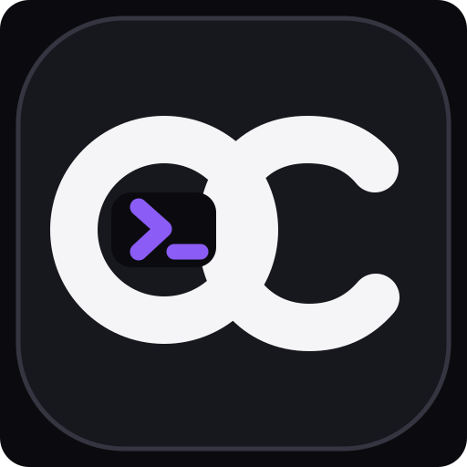
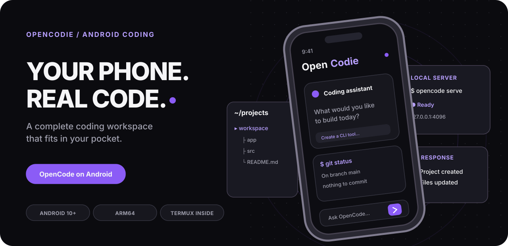
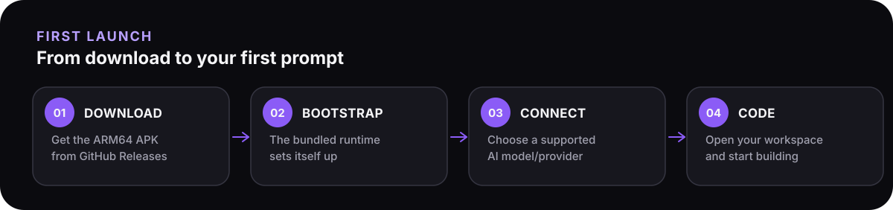
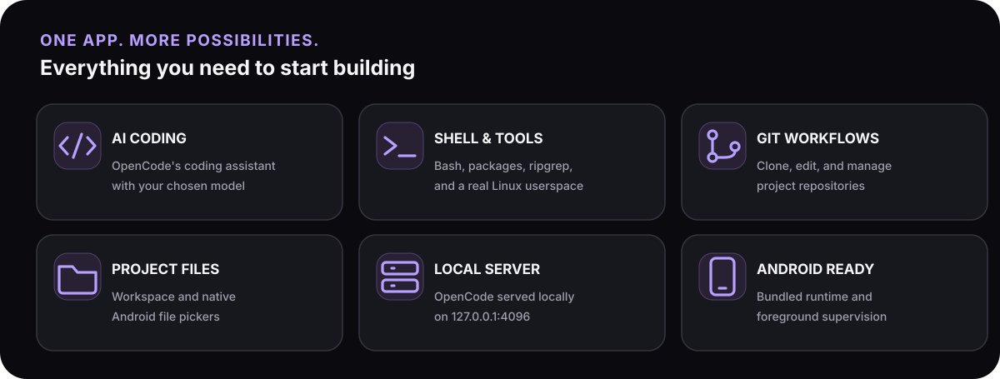
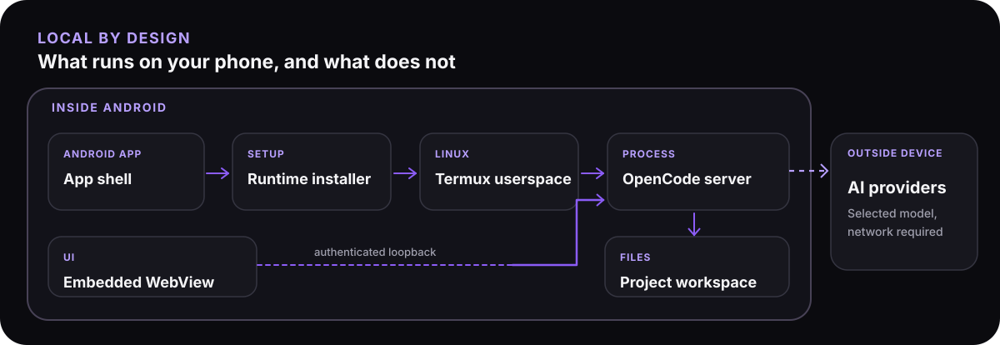

<div align="center">



<h1>OpenCodie</h1>

<a href="https://github.com/anthracite-labs/OpenCodie/actions/workflows/build-and-release.yml"></a>
<a href="https://github.com/anthracite-labs/OpenCodie/releases"></a>
<a href="LICENSE"></a>


<p><strong>What if your phone could host its own OpenCode server?</strong></p>

<p><strong>📱 Run OpenCode on Android with a bundled Termux environment and an integrated coding interface—without installing Termux separately. ⚡</strong></p>



<p><a href="https://github.com/anthracite-labs/OpenCodie/releases"><strong>Download OpenCodie.apk</strong></a> · <a href="#-quick-start">Quick start</a> · <a href="#-build-from-source">Build from source</a> · <a href="https://github.com/anthracite-labs/OpenCodie/issues">Report an issue</a></p>

</div>

> [!IMPORTANT]
> **Termux compatibility:** OpenCodie uses Android package ID `com.termux`, the same as the standalone Termux app. They cannot coexist as separate installs. Back up existing Termux data before changing installations, and do not uninstall Termux just to try OpenCodie.

## Why OpenCodie?

**The problem:** AI coding agents expect a shell, filesystem, and development tools. Android normally does not provide that environment out of the box.

**The solution:** OpenCodie puts the [OpenCode](https://github.com/anomalyco/opencode) server and Web UI together with a native [Termux](https://termux.dev/) userspace in **one ARM64 APK**. On first launch, the Android host prepares the runtime and opens the local coding interface.

**The result:** Work with project files, Git, shell commands, and an AI coding assistant from your Android device—without assembling the runtime yourself.

> **1 APK** · **Android 10+** · **ARM64** · **OpenCode v2.2.2** (pinned in [`runtime.lock`](runtime.lock))

### Contents

- [Quick start](#-quick-start)
- [What is included](#-what-is-included)
- [How it works](#-how-it-works)
- [Configuration and files](#-configuration-and-files)
- [Build from source](#-build-from-source)
- [Tests](#-tests)
- [Troubleshooting](#-troubleshooting)
- [Contributing](#-contributing)
- [License and acknowledgments](#-license-and-acknowledgments)

## 🚀 Quick start



**Requirements:** Android **10+** (API 29+) on an **ARM64 / aarch64** device; enough space for the approximately 153 MiB download and the extracted runtime; and access to an AI model/provider supported by OpenCode. Provider credentials and internet access may be required.

1. Visit [GitHub Releases](https://github.com/anthracite-labs/OpenCodie/releases), select the newest suitable build, and download **`OpenCodie.apk`**. Builds may be labeled *pre-release*.
2. Install the APK through Android's package installer. If prompted, permit installs from the browser or file manager you used. **Read the Termux compatibility warning above first.**
3. Open **OpenCodie**. The bundled Termux environment is extracted and configured on first launch; subsequent launches reuse it.
4. When OpenCode appears, connect a supported AI provider/model using OpenCode's interface and start a session. Grant storage access only if you want shared Android folder links.

**Your first task:** Ask OpenCode:

```text
Create a Python hello-world project in ~/projects/workspace/hello,
explain the files, then run it and show me the output.
```

OpenCodie includes the runtime, **not a free or offline AI model**. Model connectivity, credentials, costs, and availability depend on the provider you choose.

## ✨ What is included



| Capability | Benefit |
| --- | --- |
| **OpenCode v2.2.2** | Pinned OpenCode server and mobile-adjusted Web UI |
| **Bundled Termux** | Bash, `pkg` / APT, Git, ripgrep, libc++, and supporting tools |
| **Android WebView** | An integrated interface to the local OpenCode server |
| **Local session pairing** | Server bound to `127.0.0.1:4096`, with a generated password and browser pairing |
| **Project workspace** | OpenCode starts in `~/projects/workspace` |
| **Native file pickers** | Import/export through Android pickers; optional shared storage links |
| **Foreground service** | Monitors the server and restarts it after unexpected exits |
| **Pinned native components** | Android/Bionic OpenCode binary, PTY integration, and file watcher |

OpenCodie provides OpenCode's **Web UI**, not a standalone Termux terminal screen. Use OpenCode's shell tooling to run commands.

## 🧩 How it works



On first launch, `RuntimeInstaller` verifies and extracts the embedded archive, runs Termux's package setup, and writes initial OpenCode configuration. `OpenCodeHost` launches `opencode serve --hostname 127.0.0.1 --port 4096` and pairs the WebView with the server. The foreground service supervises this process.

WebView file-URL access stays disabled. Uploads and exports use native Android pickers, while cleartext HTTP is allowed only for the loopback OpenCode server. See [`MainActivity.kt`](app/src/main/java/com/termux/MainActivity.kt) and [`OpenCodeHost.kt`](app/src/main/java/com/termux/OpenCodeHost.kt).

## ⚙️ Configuration and files

| Path | Use |
| --- | --- |
| `~/projects/workspace` | Default working directory |
| `~/.config/opencode/opencode.json` | OpenCode and provider configuration |
| `~/.config/opencode/AGENTS.md` | Android/Termux-specific agent instructions |
| `~/storage/` | Optional shortcuts to shared Android folders after permission is granted |

Valid user configuration is preserved. Missing launch-critical defaults may be merged after creating a backup; malformed configuration is backed up before being replaced with a valid default. Existing agent guidance is not overwritten.

Install Termux packages with **`pkg`**, not `sudo`. For agent-run installs use `pkg install -y PACKAGE` and check the exit status. Create Git repositories inside named directories beneath `~/projects` rather than initializing Git in the home directory or directly in `~/projects`.

## 🛠️ Build from source

**Host requirements:** Linux x86_64, Java 17, Android SDK Platform **37** and Build Tools **37.0.0**, Android NDK **r28b**, Bun **1.4.4**, Rust/Cargo (including the `aarch64-linux-android` target), Python 3, Git, and standard native/archive build tools. The scripts fetch pinned upstream source and build a substantial bundled runtime.

```bash
git clone https://github.com/anthracite-labs/OpenCodie.git
cd OpenCodie

export ANDROID_HOME=/path/to/android-sdk
export ANDROID_NDK_HOME=/path/to/android-ndk-r28b

bash scripts/build-opencode.sh
bash scripts/build-runtime.sh
./gradlew --no-daemon :app:assembleDebug
```

The debug APK is generated at `app/build/outputs/apk/debug/app-debug.apk`. All runtime version pins live in [`runtime.lock`](runtime.lock). For a signed APK, [`scripts/build-release.sh`](scripts/build-release.sh) requires a configured release keystore and the `OPENCODIE_KEYSTORE_*` and `OPENCODIE_KEY_*` environment variables. [GitHub Actions](.github/workflows/build-and-release.yml) builds, verifies, signs, and publishes the downloadable `OpenCodie.apk`.

## ✅ Tests

```bash
python3 -m unittest discover -s tests -p 'test_*.py'
./gradlew --no-daemon :app:testDebugUnitTest
```

Python release-contract tests cover packaging and configuration invariants. JVM tests exercise the second-stage process runner and WebView session selection. GitHub Actions also verifies the assembled Android APK and its runtime contents.

## 🩺 Troubleshooting

| Problem | What to check |
| --- | --- |
| APK installation fails | Android 10+, ARM64, and any installed package using `com.termux` |
| Startup takes time or fails | The first-run Termux bootstrap must complete; include the displayed error in an issue |
| WebView says “reconnecting” | The supervisor may be restarting the loopback server |
| Shared folders are missing | Grant storage permission if desired and retry `termux-setup-storage` via shell tooling |
| `sudo` is unavailable | Use Termux's `pkg` package manager |
| AI operations fail | Provider selection, credentials, network access, and provider availability |

**Security:** The local server binds to loopback and uses a per-install generated password. Requests to external model providers can still leave the device. Review shell permissions before approving agent actions.

## 🤝 Contributing

[Open an issue](https://github.com/anthracite-labs/OpenCodie/issues) for bugs or feature proposals. For runtime problems, include the Android version, device architecture, reproduction steps, and any visible error. Run the [tests](#-tests) before sending a pull request and explain changes to pinned dependencies.

If this project helps you, [star OpenCodie](https://github.com/anthracite-labs/OpenCodie) to help others find it.

## 📄 License and acknowledgments

OpenCodie-owned code is licensed under [MIT](LICENSE). **The root license does not relicense bundled third-party software.** See [THIRD_PARTY_NOTICES.md](THIRD_PARTY_NOTICES.md) for upstream license obligations and attribution.

Built with [OpenCode](https://github.com/anomalyco/opencode), [Termux](https://termux.dev/), and [Bun](https://bun.sh/). The Android build approach also draws on [Astreele/opencode-android](https://github.com/Astreele/opencode-android).
